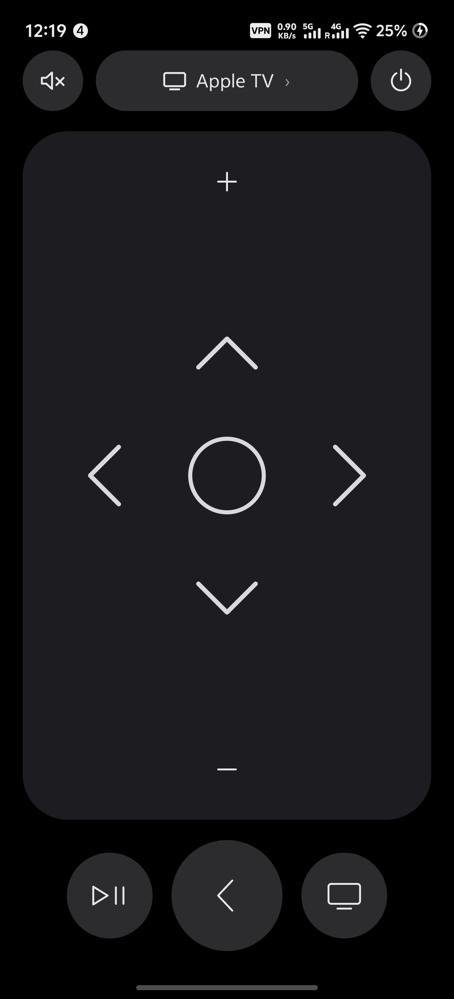

# Apple TV Remote

Unofficial Android remote for Apple TV. It talks to the TV over infrared (NEC), so the phone needs a built-in IR blaster.

Not affiliated with Apple.



## What you need

- An Android phone with an IR emitter (common on Xiaomi, Redmi, POCO, Huawei, some Samsung and vivo models). Google Pixel phones do not have one.
- Android 7.0 (API 24) or later.
- An Apple TV that can learn a third-party remote.

## Pairing

On the Apple TV: **Settings → Remotes and Devices → Learn Remote → Start**.

Point the phone’s IR window at the Apple TV from about 5–8 cm (2–3 in). For each button tvOS names, press and hold the matching control in the app until the TV accepts it. After that, the main remote screen is enough for day-to-day use.

Tap the **Apple TV** pill on the remote screen to open pairing again.

## Build

```bash
./gradlew assembleDebug
```

Install on a USB device:

```bash
./gradlew installDebug
# or
adb install -r app/build/outputs/apk/debug/app-debug.apk
adb shell am start -n com.example.appletvremote/.MainActivity
```

Unit tests:

```bash
./gradlew testDebugUnitTest
```

SDK path lives in `local.properties` (`sdk.dir=...`). That file is gitignored; Android Studio and the Gradle plugin create it locally.

## Layout

On phones the UI is a full-screen pad (D-pad, select, volume +/−) with circular mute, power, play/pause, back, and TV/Home keys. A hardware-style Siri Remote drawing is used only on large tablets.

## License

MIT. See [LICENSE](LICENSE).
